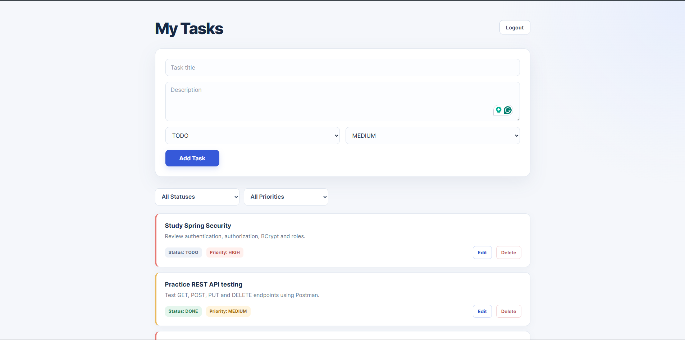
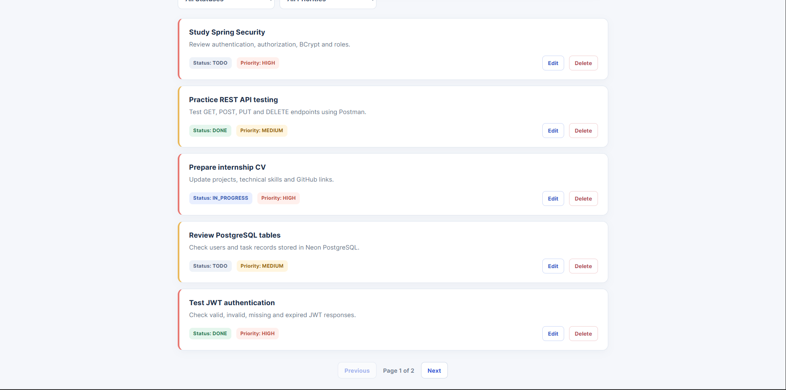
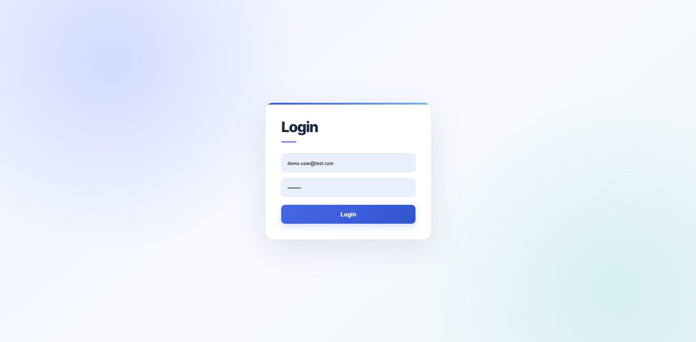
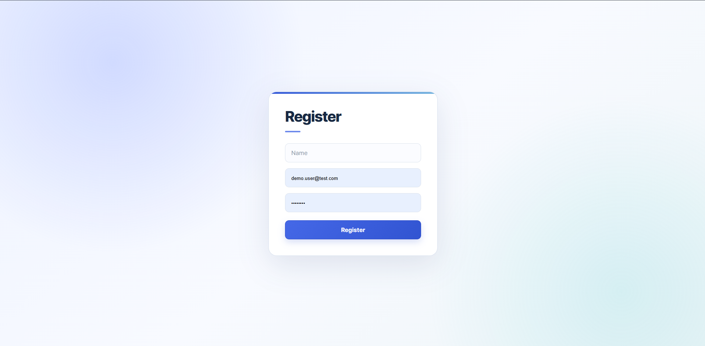

# Personal Task Manager — Frontend

A responsive frontend for a full-stack Personal Task Manager application built with **React and Vite**.

The application allows users to securely register, log in, and manage their own tasks through a Spring Boot REST API.

## Live Demo

**Application:**  
https://personal-task-manager-frontend-six.vercel.app

## Backend Repository

https://github.com/kdinethdovindu/Personal-task-manager

## Features

- User registration
- User login with JWT authentication
- Protected task page
- Create tasks
- Edit tasks
- Delete tasks
- Task status management
  - TODO
  - IN_PROGRESS
  - DONE
- Task priority management
  - LOW
  - MEDIUM
  - HIGH
- Filter tasks by status
- Filter tasks by priority
- Pagination
- Logout
- Authentication/error handling
- Automatic redirect when JWT is missing or invalid
- Responsive desktop and mobile interface

## Tech Stack

- React 19
- Vite
- React Router
- JavaScript
- CSS
- REST API
- JWT Authentication
- Vercel

## Screenshots

### Task Dashboard



### Task List



### Login



### Register



### Mobile View


## Project Structure

```text
src/
├── api/
│   └── apiConfig.js
├── components/
│   └── ProtectedRoute.jsx
├── pages/
│   ├── LoginPage.jsx
│   ├── RegisterPage.jsx
│   └── TaskPage.jsx
├── App.jsx
├── main.jsx
└── index.css
```

## Getting Started

### Prerequisites

Make sure you have installed:

- Node.js
- npm
- Git

### Clone the repository

```bash
git clone https://github.com/kdinethdovindu/personal-task-manager-frontend.git
cd personal-task-manager-frontend
```

### Install dependencies

```bash
npm install
```

### Configure environment variables

Create a `.env` file in the project root:

```env
VITE_API_BASE_URL=http://localhost:8080
```

For production, `VITE_API_BASE_URL` should point to the deployed backend.

### Start development server

```bash
npm run dev
```

The application will normally run at:

```text
http://localhost:5173
```

### Production build

```bash
npm run build
```

## Authentication Flow

```text
Register / Login
      ↓
Spring Boot Authentication API
      ↓
JWT returned after successful login
      ↓
JWT stored by frontend
      ↓
Bearer token sent with task requests
      ↓
Protected task APIs
```

## Backend Integration

The frontend communicates with the Spring Boot backend through REST endpoints for:

- Authentication
- Task creation
- Task retrieval
- Task updating
- Task deletion
- Filtering
- Pagination

Each authenticated task request includes:

```text
Authorization: Bearer <JWT>
```

## Deployment

The frontend is deployed using **Vercel**.

Production API configuration is supplied using:

```env
VITE_API_BASE_URL
```

The backend is also deployed separately and uses a Neon PostgreSQL database.

## Related Repository

**Spring Boot Backend:**  
https://github.com/kdinethdovindu/Personal-task-manager

## Purpose

This project was developed as a hands-on full-stack project to practise and strengthen skills in:

- React
- REST API integration
- Authentication
- JWT
- Spring Boot
- Spring Security
- PostgreSQL
- Full-stack deployment

## Author

**kdinethdovindu**

GitHub:  
https://github.com/kdinethdovindu
